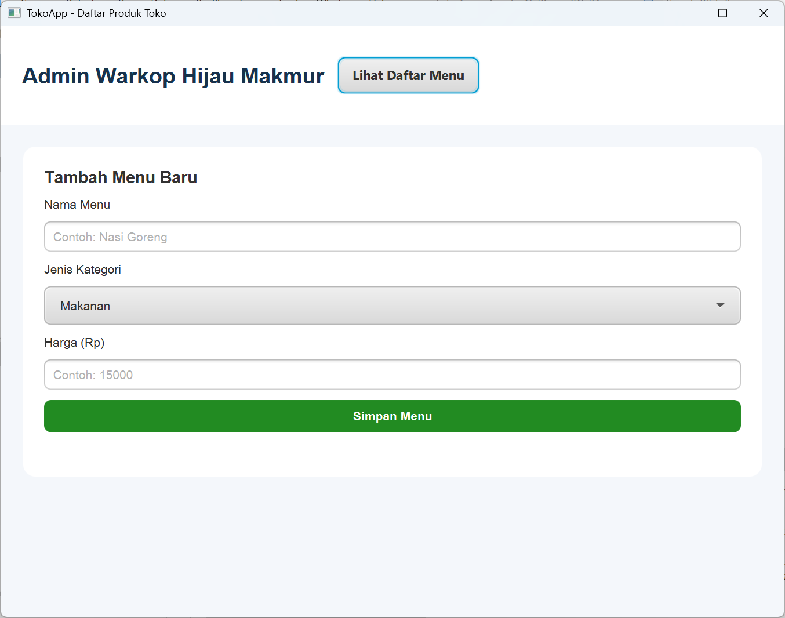
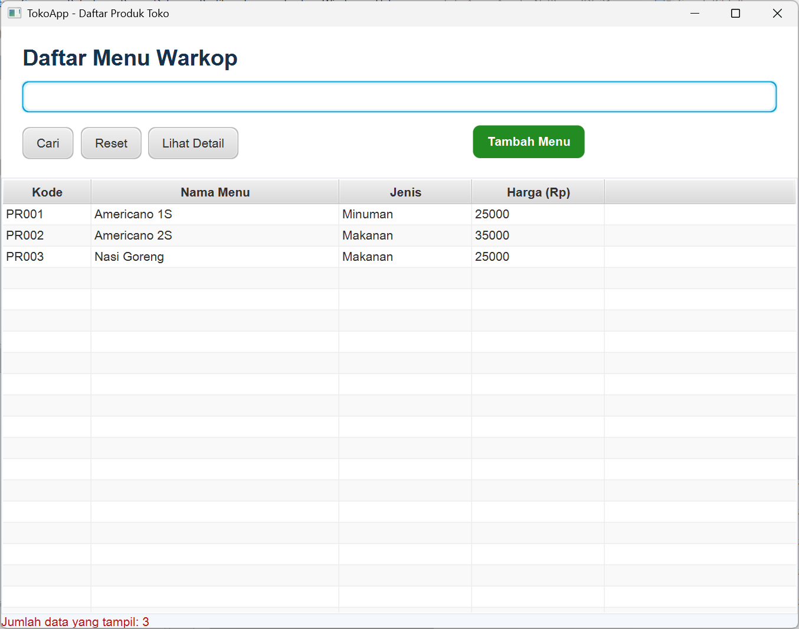
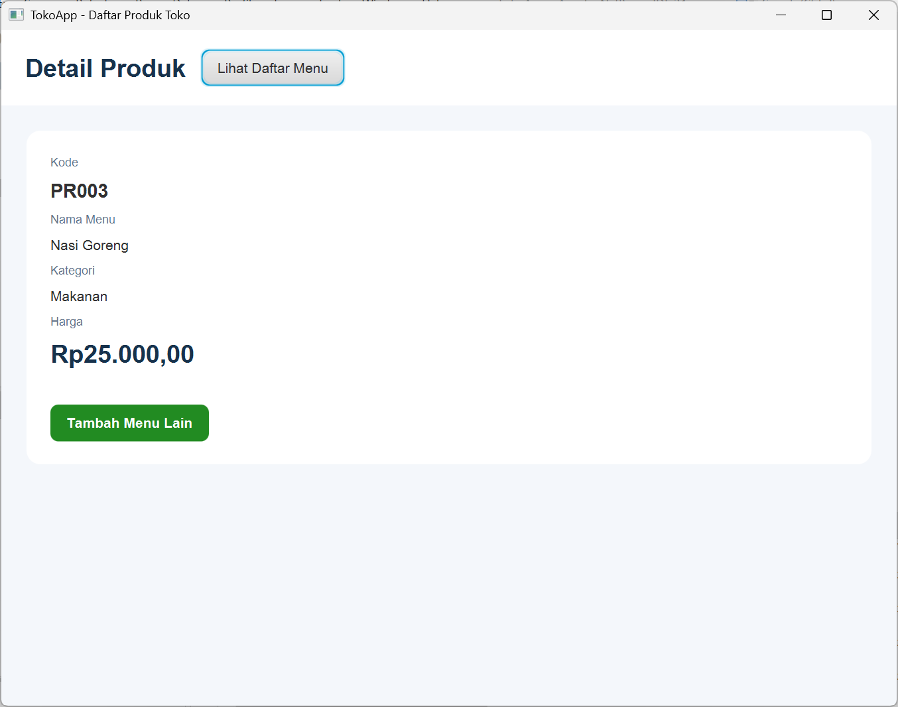

# App Admin Warkop

Aplikasi desktop berbasis Java untuk membantu pengelolaan administrasi dan operasional warung kopi (warkop) melalui antarmuka grafis (GUI). Project ini dikembangkan sebagai implementasi pembelajaran pemrograman Java, Object-Oriented Programming (OOP), dan pengembangan aplikasi desktop.

## 📌 Tentang Project

**App Admin Warkop** merupakan aplikasi yang dirancang untuk memudahkan pengelola warung kopi dalam melakukan pengelolaan data dan aktivitas operasional secara digital.

Aplikasi ini menggunakan JavaFX sebagai teknologi antarmuka grafis dan Maven sebagai build management tool.

## ✨ Fitur

- Pengelolaan data menu dan produk.
- Pengelolaan data transaksi.
- Pengelolaan informasi produk dan harga.
- Antarmuka grafis yang interaktif dan mudah digunakan.
- Pengelolaan data menggunakan konsep Object-Oriented Programming (OOP).

## 🖥️ Tampilan Aplikasi

### Form (Menu Awal)


### Daftar Menu


### Detaim Menu


## 🛠️ Teknologi yang Digunakan

- **Java** – Bahasa pemrograman utama.
- **JavaFX** – Framework untuk membangun antarmuka grafis.
- **FXML** – Mendefinisikan struktur tampilan aplikasi.
- **Maven** – Dependency management dan project build.
- **Apache NetBeans** – Integrated Development Environment (IDE).


## 🚀 Cara Menjalankan Project

1. Clone repository:

   ```bash
   git clone https://github.com/hizbaiyl/AppTokoWarkop.git
   ```

2. Buka Apache NetBeans.
3. Pilih **File → Open Project**.
4. Pilih folder `AppTokoWarkop`.
5. Tunggu Maven menyelesaikan proses dependency resolution.
6. Jalankan project melalui NetBeans.

## 👨‍💻 Developer

**Saddad Nadzir Hizbaiyl**

- GitHub: [@hizbaiyl](https://github.com/hizbaiyl)
